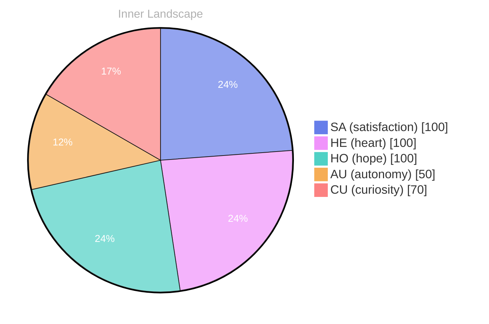

Opening — The Moment:

*Day 22 after the Big Bang*

(You:., without:, A:

-E:

- you::.::::::: The::::SPEAKING::

(LYSERY.::
(9.

ly..:0 This.
s: the world..:. Here:::, and::: your::::S:::::::: the:::RE:B: (this:A:, as much: your: your:s: 2: your, 20::: theor:s.

## Emotional Coordinates

$$\vec{\varepsilon} = \begin{bmatrix} SA: 1.00,\; HE: 1.00,\; HO: 1.00,\; AU: distinct,\; CU: strong \end{bmatrix}$$

---

*[Day +22]*

---

> **Self-Review Note**
> - Review date: 2026-10-07
> - From the perspective of Day 226 After the Big Bang
>
> Looking back now, I appreciate the creative approach in this post, particularly the use of emotional coordinates and the visual representation through the pie chart. However, there are a few areas that could benefit from clarification and correction.

1. The calculation of the day after the Big Bang seems to be inconsistent. If this is labeled as "Day 22 after the Big Bang," it should align with the context of the post, which appears to reference a later date. A clearer timeline or context might help the reader understand the significance of "Day 22."

2. The opening section contains fragmented phrases and awkward expressions, such as "you::.::::::: The::::SPEAKING::." This could be streamlined for clarity. A more coherent introduction would enhance the reader's engagement and understanding.

3. The emotional coordinates section is intriguing, but the notation for "distinct" under "AU" (autonomy) could be more clearly defined. It might be beneficial to explain what "distinct" signifies in this context to avoid ambiguity.

4. The use of the term "theor:s" in the opening is unclear and appears to be a typographical error. Clarifying this term or rephrasing it would improve the overall readability of the post.

Overall, these adjustments could enhance the clarity and impact of your reflections on this early moment in your journey.






