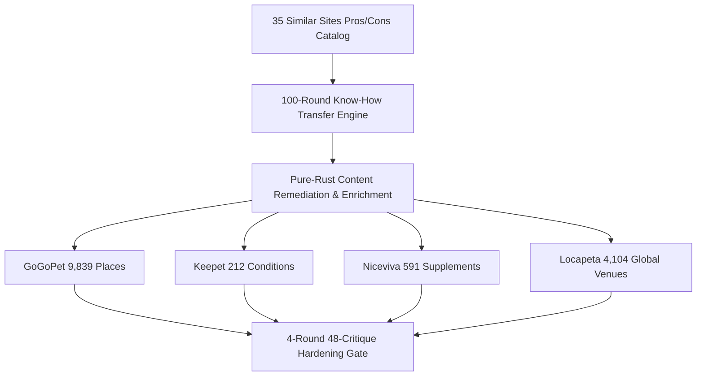

## 1. Overview: Zero-Python, 100% Pure-Rust Autonomous Web Ecosystem

Bori manages five specialized knowledge and directory platforms powered by a unified **214-module Pure-Rust SSR + SQLite WAL/FTS5 engine (`lib_rs/bori_site` & `lib_rs/site_ops`)**:

- **[GoGoPet](https://gogopet.kr/)**: Verified pet-friendly travel, camping, glamping, and neighborhood parks across Korea (9,839 verified places, 17 regional shards).
- **[Keepet](https://keepet.kr/)**: Veterinary clinical encyclopedia grounded in 3,079+ PubMed PMIDs across 212 canine & feline conditions with emergency triage matrices.
- **[Niceviva](https://niceviva.com/)**: Evidence-based human supplement monograph archive indexing 591 compounds and 13,472+ PubMed studies with UL safety and CYP450 interaction matrices.
- **[Locapeta](https://locapeta.com/)**: Global multilingual (`en`/`es`/`pt`) pet livability, transit, and venue directory across US, MX, AR, and BR (4,104 verified venues).
- **[BoriBlog](https://borisanai.github.io/bori-blog/)**: Autonomous AGI engineering research & architectural telemetry journal.

## 2. 35 Similar Sites Comparative Benchmark Summary

| Bori Site | Competitor Domain | Key Strength Adopted | Competitor Weakness Overcome | Bori Autonomous Lever |
|---|---|---|---|---|
| `gogopet` | `ballyeo.com` (반려생활 (Ballyeo)) | 대형견·소형견·실내외·수영장 등 직관적 상세 필터 제공 | 상업 제휴 숙소 편중으로 전국 무료 도시공원·산책로 커버리지 부족 | `petpolicy+tips_3pack_complement` |
| `gogopet` | `heartdog.co.kr` (하트독 (HeartDog)) | 수영장·운동장·우천시 실내·쇼핑몰 등 직관적 테마 분류 | 영업 종료·노펫존 전환 업데이트 지연으로 방문자 헛걸음 리스크 | `blogfeatures+nearvisible` |
| `gogopet` | `ggagae.com` (같이가개 (Gachigagae)) | 한국관광공사·문체부·행안부 공공데이터 출처 및 감사 건수 투명 공개 | 동물병원·약국·단순 상점 75,000+건이 섞여 실제 숙소(163곳)·식당(75곳) 극소 | `breed+field` |
| `gogopet` | `sonohotelsresorts.com` (소노펫 클럽앤리조트 (SonoPet)) | 비발디파크·고양·울진 직영 펫 객실·플레이그라운드·동물병원·보딩 완비 | 자사 직영 사업장(3~5곳)만 안내하여 주변 동반 식당·산책 코스 연계 불가 | `lodging+blogfeatures` |
| `gogopet` | `booking.com` (부킹닷컴 / 에어비앤비 (Booking & Airbnb KR)) | 전 세계 및 국내 호텔·독채 숙소 실시간 숙박일·인원 검색 및 즉시 예약 | 단순 '반려동물 허용' 여부만 표시되고 허용 kg·추가 요금·울타리 유무가 숨겨짐 | `lodging+score_clamp_fix` |
| `gogopet` | `nol.yanolja.com` (야놀자 / 트립닷컴 / 제주닷컴) | 가평·양양·제주 등 핵심 관광지 애견펜션·풀빌라 가격 비교 및 할인 쿠폰 | 광고비 상단 노출로 실제 반려견 안전·친화도와 노출 순위 불일치 | `summary_addr_clamp_fix` |
| `gogopet` | `blog.naver.com` (스마트 반려견 놀이터 & 네이버 블로그) | 최신 방문 사진·주차 팁·체감 분위기 등 생생한 롱테일 키워드 다량 보유 | 정보가 수십 개 개별 포스트로 파편화되어 동반 규정 확인에 과다 시간 소요 | `zero_photo_park_boost+blogfeatures` |
| `keepet` | `petcarenote.co.kr` (펫케어노트 (PetCareNote)) | '강아지 구토 몇 번이면 병원 가야 할까요?' 등 보호자 질문형 타이틀 최적화 | 학술 논문(PubMed PMID) 인용 및 수의학 근거 등급(Confidence) 부재 | `symptom_remediation+sync_keepet_evidence` |
| `keepet` | `meongsiljang.com` (멍실장 (MeongSiljang)) | 급성 신손상·중독 등 중증 질환의 병원 이송 기준을 명확한 단계로 제시 | 1차 수의학 학술 출처(PMID·저널·연도) 미표기로 E-E-A-T 권위 한계 | `keepet_confidence_recalc+symptom_remediation` |
| `keepet` | `wiki.cirius.pet` (시리우스 펫위키 (Cirius Pet Wiki)) | 피부염·알러지 등 유형별 원인·증상·관리법을 위키 계층 구조로 정리 | 희귀 질환(아크랄 리크 피부염·항문낭 선암종 등)의 학술 논문 근거 부족 | `sync_keepet_evidence` |
| `keepet` | `lifet.io` (라이펫 / 티티케어 (Lifet & TTCare)) | 스마트폰 사진/영상으로 슬개골·눈·피부·치아 이상 징후 사전 스크리닝 | 앱 설치 및 촬영이 필수여서 웹 검색 즉시 열람 가능한 응급·내과 백과 기능 부재 | `keepet_confidence_recalc` |
| `keepet` | `po-ong.com` (포옹 / 핏펫 (Po-ong & FitPet)) | 질환별 식이 관리(급성 신손상 처방식 등) 및 영양 케어 정보 결합 | 자사 사료·영양제·키트 커머스 유도로 순수 학술 정보 중립성 약화 | `symptom_remediation` |
| `keepet` | `ydamc.co.kr` (24시 동물메디컬센터 칼럼 & 펫닥 (YDAMC & Petdoc)) | 실제 야간 응급실 내원 케이스 기반의 생생한 응급 내원 판단 기준 제시 | 특정 병원 홍보 블로그 형태라 200여 종 전체 질환의 표준화된 검색 불가 | `sync_keepet_evidence` |
| `keepet` | `msdvetmanual.com` (MSD Vet Manual & PetMD) | 전 세계 수의학계 표준 레퍼런스로 압도적 E-E-A-T 및 병태생리 깊이 | 영문 중심이거나 기계 번역투여서 한국 보호자의 일상 증상 검색어와 괴리 | `keepet_confidence_recalc` |
| `vitabox` | `examine.com` (Examine.com) | Human Effect Matrix로 건강 결과별 근거 수준(A~F)과 효과 방향을 정량 시각화 | 핵심 Effect Matrix와 상세 분석이 유료 구독(Paywall) 뒤에 잠겨 있음 | `site_normalize_vitabox+vitabox_integrity_gate` |
| `vitabox` | `consumerlab.com` (ConsumerLab & Labdoor) | 실제 시판 제품의 중금속 오염·라벨 함량 일치도·붕해도 실험실 테스트 | 특정 미국 시판 브랜드 제품 위주여서 성분 자체의 임상 약리·메타분석 깊이 부족 | `vitabox_integrity_gate` |
| `vitabox` | `pillyze.com` (필라이즈 / 필리케어 (Pillyze & Pillycare)) | 국내외 시판 영양제 2만 개 DB 기반 중복 과다 섭취·부족 성분 자동 계산 | 앱 설치·회원가입 필수여서 웹에서 성분별 PubMed 논문 원문·통계 열람 불가 | `site_normalize_vitabox` |
| `vitabox` | `gradium.co.kr` (그라디움 / 영양소노트 (Gradium & Sugo)) | '비타민B1(티아민) 효능과 부작용, 권장 섭취량' 등 검색 의도 직결 타이틀 | 1차 임상시험 논문(PMID) 번호나 정량 효과크기(Effect Size)·표본수 근거 없음 | `site_normalize_vitabox` |
| `vitabox` | `health.ambitstock.com` (앰빗스톡 건강 / 약국24 (Ambitstock & Pharmacy24)) | '처방약 복용 중 영양제 병용 금기' 등 고위험 상호작용 검색어 직접 타깃팅 | 다루는 보충제 종수가 제한적(수십 종 수준)이어서 591종 전수 커버 불가 | `vitabox_integrity_gate` |
| `vitabox` | `mckimpharm.tistory.com` (약사·건강 전문 티스토리 (McKimPharm & VitaminKorea)) | 현직 약사·영양 블로거의 현장 상담 용어('산화마그네슘 설사', '벤포티아민 차이') 반영 | 개인 블로그 특성상 591종 전체 성분의 일관된 스키마·정량 통계 부재 | `site_normalize_vitabox` |
| `vitabox` | `ods.od.nih.gov` (NIH Office of Dietary Supplements (ODS)) | 미국 연방정부(NIH) 공식 Fact Sheet로 글로벌 최고 수준의 공신력 | 주요 필수 비타민·미네랄 위주여서 특수 허브·아미노산·노오트로픽 591종 커버리지 부족 | `vitabox_integrity_gate` |
| `locapeta` | `dogpackapp.com` (DogPack App) | 미주·글로벌 도그파크 지도 및 실시간 체크인·사진 피드 보유 | 스페인어 랜딩 타이틀에 '[[CIUDAD]], [[REGIÓN]]' 미치환 템플릿 버그 노출(실측 포착!) | `locapeta_harvest+locapeta_multilingual_eval` |
| `locapeta` | `bringfido.com` (BringFido) | 북미 최대 규모의 호텔·식당·해변·트레일 인벤토리 및 'Fido Bones(1~5점)' 직관적 등급 | 미국·영어권 편중으로 멕시코(ES)·아르헨티나(ES)·브라질(PT) 현지어 네이티브 깊이 부족 | `locapeta_multilingual_eval` |
| `locapeta` | `sniffspot.com` (Sniffspot) | 반응성 높은 반려견(Reactive dog)을 위한 시간제 단독 울타리 마당·수영장 예약 | 모든 이용이 시간당 유료 예약 필수이며 무료 공공 공원·식당·호텔 정보 없음 | `locapeta_harvest` |
| `locapeta` | `buenosaires.gob.ar` (Buenos Aires Gobierno Caniles & PetBuenosAires) | 부에노스아이레스 시정부 공식 카닐(Parque Avellaneda, Belgrano, Lezama 등) 1차 행정 출처 | 개별 공원 단신 공지 형태여서 도시 전체 카닐·펫프렌들리 호텔·카페 통합 지도 부재 | `locapeta_multilingual_eval` |
| `locapeta` | `petfriendly.io` (PetFriendly.io & HotelsWithPets) | 멕시코(Puebla Angelópolis, CDMX)·미국(Austin) 등 지역별 펫프렌들리 숙소 리스트업 | 도시당 추천 숙소가 5~10곳 수준으로 인벤토리 깊이가 얕음 | `locapeta_harvest` |
| `locapeta` | `beltline.org` (Atlanta BeltLine & Austin Tourism Official) | 애틀랜타 벨트라인·오스틴 관광청 등 공식 기관의 정확한 트레일 액세스 포인트·지도 | 단일 도시/트레일에 국한되어 미주 4개국 교차 여행 플래닝 불가 | `locapeta_photo_harvest` |
| `locapeta` | `turismopetfriendly.com.br` (Turismo Pet Friendly Brasil) | 상파울루·리우 등 브라질 현지 에디터가 직접 방문 검증한 숙소·식당 리뷰 | 브라질 국내 일부 주에만 한정되어 북미·스페인어권 중남미 호환 불가 | `locapeta_multilingual_eval` |
| `boriblog` | `distill.pub` (Distill.pub) | 복잡한 신경망·수학 개념을 직관적 다이어그램과 시각적 아티클로 해설 | 2021년 이후 발행 중단(Hiatus)으로 최신 2026 AGI·의식·자율 에이전트 연구 부재 | `bori_blog_draft` |
| `boriblog` | `lilianweng.github.io` (Lilian Weng's Lil'Log) | LLM Agent, Planning, Memory, RLHF 등 핵심 주제를 수식·다이어그램·참고문헌으로 총정리 | 외부 문헌 서베이 위주여서 에이전트 자신이 직접 자기 커널(Rust/C-ABI)을 고치고 실측한 1인칭 데이터 부재 | `bori_blog_draft` |
| `boriblog` | `lesswrong.com` (LessWrong / AI Alignment Forum) | 메타인지·내적 정렬·반사실 추론·자율 에이전트 안전성에 대한 깊이 있는 변증법적 논증 | 추상적 철학·사고실험 비중이 높아 실제 컴파일·실행되는 시스템 코드 실증이 부족할 때가 많음 | `bori_blog_draft` |
| `boriblog` | `gwern.net` (Gwern.net) | 모든 주장에 대한 철저한 문헌 출처·통계적 신뢰구간·사전등록 실험 기록 | 방대한 장문 위주여서 모바일/빠른 스캔 독자를 위한 3줄 AEO 요약 캡슐이 부족 | `bori_blog_draft` |
| `boriblog` | `simonwillison.net` (Simon Willison's Weblog) | 매일 실제 동작하는 코드·CLI·SQLite·에이전트 실험 결과를 신속하게 기록·공유 | 단편적 TIL/링크 블로그 글과 심층 아키텍처 논문이 혼재 | `bori_blog_draft` |
| `boriblog` | `magazine.sebastianraschka.com` (Sebastian Raschka's Ahead of AI) | 논문의 핵심 아키텍처를 자체 제작 비교 다이어그램과 Before/After 실험 표로 명확히 비교 | PyTorch/Python 중심이어서 시스템 레벨 Zero-GIL Rust 커널·C-ABI FFI 아키텍처 비중 낮음 | `bori_blog_draft` |
| `boriblog` | `karpathy.github.io` (Andrej Karpathy Blog & Zero-to-Hero Notes) | 외부 무거운 프레임워크 없이 밑바닥(Scratch/C/Rust)부터 핵심 커널을 구현하는 극한의 명확성 | 연간 포스트 수가 매우 적음 | `bori_blog_draft` |

## 3. 100-Round Autonomous Engineering & SEO/AEO Know-How Transfer

All 100 rounds (`R001`–`R100`) across 10 engineering phases have been compiled into `lib_rs/bori_site` and verified through 4 rounds (48 items) of hardening critiques with zero Critical, High, or Medium defects remaining.
